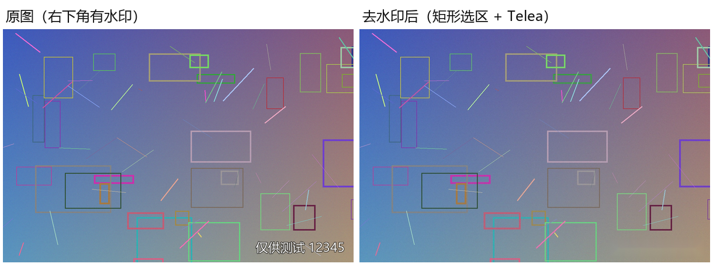

# 批量水印工具

一个 Windows 本地批量去水印 / 加水印的小工具，使用 Python + Tkinter + OpenCV 编写。

- 不需要联网
- 不调用 AI 接口
- 不修改原图
- 结果自动输出到 `去水印` / `加水印` 子文件夹



## 功能

### 批量去水印

- 选择图片文件夹，自动加载第一张图作为样图
- 在样图上用矩形、画笔、橡皮绘制要修复的水印范围
- 支持标准 Telea 修复和纹理 ShiftMap 修复
- 可选模板匹配，适合每张图水印位置不同的情况
- 预览后批量处理，输出到原文件夹下的 `去水印` 子文件夹
- 原图不修改、不覆盖；重名自动加序号

### 批量加水印

- 文字水印：字体、字号、颜色、透明度、边距
- Logo 水印：按宽度比例缩放、透明度、边距
- 固定加在右下角
- 输出到原文件夹下的 `加水印` 子文件夹

### 通用

- 支持 jpg / jpeg / png / bmp / webp / tif / tiff
- 可选包含子文件夹，并保留相对目录结构
- 进度条、处理日志、取消、打开输出文件夹
- 兼容中文路径

## 环境

- Windows 10 / 11，64 位
- Python 3.10 及以上（开发和测试使用 3.12.14）

## 运行源码

```bat
cd /d 本目录
python -m pip install -r requirements.txt
python app.py
```

也可以双击 `运行.bat`。

依赖：

```text
opencv-contrib-python-headless==4.10.0.84
numpy==2.3.5
Pillow==12.3.0
```

## 打包成 exe

```bat
python -m pip install "pyinstaller==6.22.3"
python -m PyInstaller --noconfirm --clean --windowed --name "批量水印工具" --distpath "发布" --workpath "build" app.py
```

或直接双击 `打包.bat`。

打包结果是 one-folder 模式，`批量水印工具.exe` 必须和 `_internal` 文件夹放在一起，不能只拷贝 exe。

## 文件说明

| 文件 | 说明 |
| --- | --- |
| `app.py` | Tkinter 界面、选区绘制、批量任务、输出控制 |
| `core.py` | OpenCV 去水印/加水印算法核心 |
| `test_core.py` | 合成图自测脚本 |
| `requirements.txt` | Python 依赖 |
| `使用说明.txt` | 给最终用户的操作说明 |
| `源码说明.txt` | 更详细的实现说明和二次开发入口 |
| `运行.bat` | 直接运行源码 |
| `打包.bat` | 一键安装 PyInstaller 并打包 |

## 实现说明

- 使用 `cv_imread` / `cv_imwrite` 通过 `np.fromfile` + `cv2.imdecode`、`cv2.imencode` + `tofile` 兼容中文路径。
- 去水印时先把 mask 向外膨胀，盖住水印抗锯齿边缘；只对 mask 外接矩形附近区域做 inpaint，避免整图计算过慢。
- `Telea` 速度快，适合大多数小面积水印；`ShiftMap` 是 OpenCV xphoto 的纹理修复，速度稍慢，复杂背景可尝试。
- xphoto 的 mask 语义与 `cv2.inpaint` 相反：非零表示有效区域，所以 ShiftMap 分支传入了 `bitwise_not(mask)`。
- 加水印使用 Pillow 绘制文字或粘贴 Logo，再按透明度合成到右下角。

## 已知限制

- 这是传统内容感知修复，不是 Photoshop 的 AI 生成式填充。水印面积大、背景纹理复杂时，修复区域可能模糊或有涂抹感。
- 图片尺寸差异很大时，固定 mask 按比例缩放可能对不准；建议同尺寸批量处理，或使用模板匹配。
- 模板匹配在重复纹理、纯色背景上可能误匹配，建议先处理一张检查。
- 带透明通道的 PNG 输出会转为 RGB。
- ShiftMap 为实验性选项，大矩形选区可能产生纹理拖影。

## 免责声明

请只处理你拥有版权或已获得授权的图片。工具只提供图像修复能力，使用后果由使用者自行承担。

## License

当前未附带开源协议。如需开源，建议自行添加 MIT License，或按你的需要选择其他协议。
